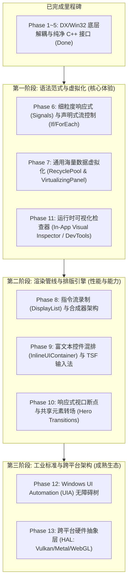

# CUI 框架演进与任务追踪清单 (task.md)

> **当前工程状态**：
> - ✅ **历史里程碑已完成**：DirectX / Win32 底层类型深度解耦与纯净 C++ API 清洗（Phase 1 ~ Phase 5 全部通过，零 DX/Win32 头文件泄漏，通过全量编译与主题门禁）。
> - 🚀 **新一阶段目标**：对标工业级 UI 框架（WinUI 3、Flutter、Qt、Slint），全面补齐语法范式、合成渲染管线、数据虚拟化、富文本排版、无障碍体系与开发者工具链。

---

## 🗺️ 全局演进路线图（Roadmap Overview）

---

## 📌 历史归档里程碑（已全部验收）

<b>点击展开已完成的 Phase 1 ~ Phase 5（底层纯净化与解耦）</b>

- [x] **Phase 1: 核心基础类型与色彩系统纯净化 (Color & Primitives)**
  - [x] 1.1 扩展并纯化 `Value.h` 中的 `CUI::Color`，剔除公共头文件中 `<d2d1.h>` 依赖。
  - [x] 1.2 重构主题色彩标记表 `ThemeTokens`，全量改用 `CUI::Color`。
  - [x] 1.3 清洗控件中直接引用 `D2D1_COLOR_F` 的属性与模型。
- [x] **Phase 2: 文字排版与字体系统封装 (Typography & Shaping)**
  - [x] 2.1 建立通用文本类型定义头文件 `TextTypes.h`（TextAlignment、FontWeight、TextStyle）。
  - [x] 2.2 封装内部文本布局器与缓存 `TextLayoutCache`，对外隐藏 `IDWriteTextLayout`。
  - [x] 2.3 改造 `GraphicsContext` 文字绘制与测量 API 为纯净 C++ 接口。
  - [x] 2.4 清洗 `TextBlock`、`TextBox`、`Button` 等核心文本渲染。
- [x] **Phase 3: 窗口与输入事件循环解耦 (Windowing & Input)**
  - [x] 3.1 抽象原生光标与键盘枚举 `InputTypes.h`（`CursorType`, `KeyEventArgs`）。
  - [x] 3.2 解耦控件光标返回逻辑（`GetCursorType()` 替代 `HCURSOR`）。
  - [x] 3.3 窗口消息转换与事件派发收敛至 `Window.cpp`，移除控件裸接收 `vkCode`。
  - [x] 3.4 窗口实例语义化 API 封装（隔离 `HWND`）。
- [x] **Phase 4: 渲染上下文与系统特效深度封装 (GraphicsContext & Effects)**
  - [x] 4.1 清洗 `GraphicsContext.h` 公共绘图接口，隐藏 D2D 矩阵与变换。
  - [x] 4.2 封装 Win11 Mica/Acrylic 材质与阴影配置，代码收敛至 `.cpp`。
- [x] **Phase 5: 控件库清洗与全量构建验证 (Clean-up & Verification)**
  - [x] 5.1 全局扫描控件库头文件，实现 0 DX、0 Win32 泄漏。
  - [x] 5.2 全量构建 `CUI.Core`、`CUI.Gallery`（Debug/Release），0 错误通过。

---

## 🚀 待开展演进任务列表 (New Roadmap Tasks)

---

### Phase 6: 细粒度响应式系统与声明式流控制 (Reactivity & DSL Flow) - [已完成]

- [x] **6.1 引入 C++20 细粒度响应式基语 (`Signal<T>` / `Computed<T>`)**
  - **模块位置**: `ui/framework/reactive/Signal.h`
  - **目标**: 终结“手动监听事件 -> 手动调用 ApplyXxx”的面条代码。
  - **成果**:
    - [x] 实现 `Signal<T>`：读操作自动建立依赖追踪拓扑图，写操作仅触发精确依赖节点的增量重算。
    - [x] 实现 `Computed<T>`：惰性求值与缓存失效，仅在依赖信号变更时重新计算。
    - [x] 实现 `Effect(func)`：自动订阅函数内访问的信号，在信号变动时批处理调度执行，并在宿主析构时自动清理依赖。
    - [x] 实现 `Batch(func)`：事务化合并多次信号写操作为单次下游通知。
    - [x] `UIElement` / `BindableProperty` / `PropertyRef` / `WidgetBase` 支持直接接收 `Signal<T>` 传参与双向/单向绑定。

- [x] **6.2 声明式结构控制流基语 (`If` / `ForEach` / `Switch`)**
  - **模块位置**: `ui/framework/core/CUIDsl.h`
  - **目标**: 允许在 CUI DSL 视图树中直接书写条件渲染与集合迭代。
  - **成果**:
    - [x] 实现 `If(condition_signal, then_builder, else_builder)`，动态切换渲染子树，非活动分支自动解离并释放 Effect。
    - [x] 实现 `ForEach(collection_signal, item_builder)`，监听向量信号集合变化，根据数据源自动同步重构节点序列。
    - [x] 实现 `Switch(key_signal).Case(val, builder).Default(builder)` 多分支模式匹配。
    - [x] 提供统一对象适配萃取 `Detail::ToElementShared`，透明支持 `ElementBuilder`、`WidgetBase` 句柄以及原始智能指针。

- [x] **6.3 强类型编译期绑定检查 (Type-Safe Compile-Time Bindings)**
  - **成果**:
    - [x] `BindableProperty<T>::Bind(const Signal<T>&)` 消除弱类型 Variant/PropertyId 开销。
    - [x] 建造者重载与概念约束（`std::is_invocable_r_v`、`std::convertible_to`）。
    - [x] 在 Gallery 新增 `ReactivityPage` 示例页面，通过全量 Release / Debug 编译及主题自动化规范检查。

---

### Phase 7: 通用海量数据虚拟化体系 (Universal Virtualization & RecyclePool)

- [x] **7.1 通用组件回收复用池 (`RecyclePool`)**
  - **模块位置**: `ui/framework/virtualization/RecyclePool.h`
  - **目标**: 将目前特定控件内写死的虚拟化，升级为全框架通用的回收池架构。
  - **任务要点**:
    - [x] 支持按控件类名或数据模板类型缓存已离开视口的控件实例。
    - [x] 提供 `Acquire(type)` 和 `Release(element)`，复用实例只重绑数据（Re-bind），不重新分配内存。
    - [x] 提供内存诊断接口（`GetTotalCreated()`, `GetTotalReused()`, `GetPoolSize()`, `Clear()` 等）。

- [x] **7.2 虚拟化布局面板基类 (`VirtualizingPanel` / `VirtualizingStackPanel`)**
  - **模块位置**: `ui/framework/virtualization/VirtualizingStackPanel.h`, `VirtualizingStackPanel.cpp`, `VirtualizingItemProvider.h`
  - **目标**: 将视口裁剪、滚动偏移测算与控件复用池深度融合。
  - **任务要点**:
    - [x] 仅对当前可见视口范围内的项调用 `Measure` 与 `Arrange`（单次渲染维持在 15~25 个实例）。
    - [x] 支持固定项高（Fixed Item Height）与动态项高测算缓存（Dynamic Item Height Estimator）。
    - [x] 支持平滑惯性滚动（Chromium 平滑滚动算法与物理惯性动画）与 `ScrollbarAutoHide`。
    - [x] 提供完整的键盘导航（上下箭头、PageUp/PageDown、Home/End）与选择状态管理。

- [x] **7.3 升级核心列表控件与 DSL 支持**
  - **模块位置**: `Widgets.h`, `CUIDsl.h`, `VirtualizationPage.cpp`
  - **目标**: 提供声明式 `VirtualList(...)` 与 `Fluent::VirtualizingStackPanel()` DSL。
  - **任务要点**:
    - [x] 在 `Widgets.h` 封装 `Widgets::VirtualizingStackPanel` 链式调用。
    - [x] 在 `CUIDsl.h` 提供 `VirtualList(count, itemHeight, builder)` 与 `VirtualList(Signal<vector<T>>, itemHeight, builder)`。
    - [x] 在 CUI.Gallery 建设 `VirtualizationPage` 演示百万行（1,000,000 项）数据秒开、平滑滚动、动态新增/删除与复用池实时诊断仪表盘。
    - [x] 通过全量 Release / Debug 编译及主题自动化规范检查。

---

### Phase 8: 渲染管线升级与现代合成器架构 (Rendering Pipeline & Compositor)

- [x] **8.1 绘图指令流录制模式 (`DisplayList` / Command Buffer)**
  - **模块位置**: `ui/framework/render/DrawOp.h`, `ui/framework/render/DisplayList.h`, `ui/framework/render/DisplayList.cpp`
  - **目标**: 从现有的“即时深度遍历绘制”升级为“保留式指令流录制”。
  - **任务要点**:
    - [x] 架构完整的不可变 `DrawOp` 指令类型集合（ClearRect, DrawRect, FillRect, DrawRoundedRect, FillRoundedRect, DrawLine, DrawSmoothLine, DrawSmoothArc, DrawChevron, DrawIcon, DrawSvg, DrawText, PushClip, PopClip, PushOpacity, PopOpacity, PushTransform, PopTransform 等）。
    - [x] `GraphicsContext` 深度无缝集成录制模式（`BeginRecording(list)` / `EndRecording()`），无需重写任何现有控件的 `OnRender` 即可全自动流式录制进 `DisplayList`。
    - [x] 节点支持保留式指令流缓存：`UIElement::ApplyDisplayListCacheEnabled(true)` 与 `Widgets::WidgetBase::EnableDisplayListCache()`，未发生视觉脏标记的子树 100% 直接复用指令流，跳过 CPU 运算与树遍历。
    - [x] `DisplayList::Optimize()`：合并连续同材质/同画刷绘制指令并剔除空剪裁对，实现指令级精简与 GPU 批量提交（Batching）。

- [x] **8.2 独立合成器体系 (`Compositor`)**
  - **模块位置**: `ui/framework/render/Compositor.h`, `ui/framework/render/Compositor.cpp`
  - **目标**: 隔离 UI 主线程逻辑与光栅化呈现管线。
  - **任务要点**:
    - [x] 封装 `CompositorFrame`，统一管理视口尺寸、脏区 (DirtyRegion) 与分层指令流（backgroundList, sceneList, overlayList）。
    - [x] `Compositor` 驱动帧协调、DisplayList 指令流优化与 Present 呈现。
    - [x] 提供运行时诊断度量（`CompositorDiagnostics`）：实时 FPS 追踪、GPU 光栅化耗时、指令总数与 Batching 消除率。

- [x] **8.3 自定义 GPU Shader 特效管线 (`CustomShader`) 与网格渐变控件**
  - **模块位置**: `ui/framework/render/CustomShader.h`, `ui/framework/render/CustomShader.cpp`, `ui/framework/controls/MeshGradientPanel.h`, `MeshGradientPanel.cpp`
  - **目标**: 突破传统固化 UI 限制，提供流体亚克力与现代网格渐变视觉。
  - **任务要点**:
    - [x] 实现 `CustomShader`，内置 `MeshGradient`（4 点/多点平滑网格渐变）、`FluidAcrylic`（动态流体亚克力材质与边缘镜面高光反射）、`GlowPulse`（呼吸光晕）。
    - [x] 封装通用容器面板控件 `MeshGradientPanel`，支持直接承载任意子控件，并提供流式链式 DSL：`Widgets::MeshGradientPanel()` 与 `Fluent::MeshGradientPanel()`。
    - [x] 在 CUI.Gallery 建设 `RenderPipelinePage`（收录于 Motion 目录），动态演示着色器切换、速率/光强调节、DisplayList 缓存开关与实时状态指标。
    - [x] 通过全量 Release / Debug 编译及主题自动化规范检查。

---

### Phase 9: 富文本与现代输入法系统 (Typography & TSF IME)

- [ ] **9.1 行内富文本混排树 (`InlineUIContainer` / `Run` / `Span`)**
  - **模块位置**: `ui/framework/text/Inline.h`, `ui/framework/controls/RichTextBlock.h`
  - **目标**: 允许文本段落中内嵌任意 UI 控件或跨字符样式混合。
  - **任务要点**:
    - [ ] 建立 Inline 模型树：`Run`（纯文本）、`Span`（带样式分组）、`InlineUIContainer`（内嵌任意控件）。
    - [ ] 在 `Measure` 阶段保留内嵌控件的基线与占位，在 `Arrange` 阶段将内嵌控件精确定位至对应行与文字基线。

- [ ] **9.2 现代 Windows 文本服务框架（Text Services Framework, TSF）深度集成**
  - **模块位置**: `ui/framework/text/TSFManager.h`, `TextBox.cpp`
  - **目标**: 全面接入 Windows 11 原生输入体验。
  - **任务要点**:
    - [ ] 实现 `ITextStoreACP` 接口以支持原生 TSF。
    - [ ] 支持 Win11 原生表情选择器（Win + .）、剪贴板历史浮窗（Win + V）、语音听写（Win + H）。
    - [ ] 支持触摸屏虚拟键盘呼出与界面动态避让推顶。

- [ ] **9.3 国际化多语言复杂排版与双向文本 (BiDi)**
  - **目标**: 完善阿拉伯语/希伯来语等 RTL 文本的反向排版与断词换行。

---

### Phase 10: 响应式视口断点与转场动效 (Adaptive Layout & Transitions)

- [ ] **10.1 响应式视口断点触发器 (`AdaptiveTrigger` / `Breakpoints`)**
  - **目标**: 界面在窗口缩放时能无缝自适应桌面大屏与小窗紧凑排版。
  - **任务要点**:
    - [ ] 类似 WinUI 3 `AdaptiveTrigger`：可声明在视口跨越断点（如 600px、900px、1200px）时动态应用不同的布局模式与可见性规则。

- [ ] **10.2 共享元素转场与隐式布局动效 (Hero Transitions & Implicit Layout Animations)**
  - **目标**: 跨页面导航或列表重排时消除视觉突变。
  - **任务要点**:
    - [ ] 实现卡片展开至详情页的共享元素缩放（Hero Animation）。
    - [ ] 列表增删项时，未删除的项自动平滑平移至新位置（Animated Layout）。

---

### Phase 11: 开发者工具链与工程化质量保障 (DevTools & DX)

- [x] **11.1 运行时可视树检查器 (In-App Visual Inspector / "F12 DevTools")**
  - **模块位置**: `ui/framework/devtools/VisualTreeInspector.h`, `VisualTreeInspector.cpp`, `BoxModelOverlay.h`, `BoxModelOverlay.cpp`, `DevToolsManager.h`, `DevToolsManager.cpp`
  - **目标**: 在运行时按快捷键呼出调试面板，极大提升界面排查效率。
  - **成果**:
    - [x] 全局快捷键与事件集成：`F12` 或 `Ctrl+Shift+I` 呼出可拖动、半透明亚克力的 DevTools 浮动面板；`Ctrl+Shift+C` 激活全视口元素审查模式。
    - [x] Chrome DevTools 规范盒模型诊断遮罩 (`BoxModelOverlay`)：悬停或选中元素时以标准半透明色彩分级渲染 Margin (橙色)、Border (鹅黄)、Padding (草绿)、Content (天蓝)，并附带尺寸规格与类型名浮动 Badge。
    - [x] 完整可视元素树拓扑查看器 (`VisualTreeInspector`)：分栏左侧提供层次缩进树结构，支持展开/折叠、点击选中同步更新高亮。优化滚轮滚动步长（60px/格）与可拖动专属滚动条；支持一键 `[过滤折叠]` 隐藏非活动节点，并清晰标识折叠状态 `[折叠 0×0]` 与控件文本内容（如 `NavigationViewItem "Button"`）。
    - [x] 审查模式智能聚焦：拾取点击控件后，可视树自动展开全层级祖先链路并平滑滚动将选中项居中展示在视野中央。
    - [x] 标题栏圆角细节优化：外层统一圆角裁剪，彻底解决标题栏底端内凹圆角问题，左下右下无缝贴合分割线。
    - [x] 实时属性与盒模型图解卡片：分栏右侧展示控件类名、指针地址、可见性、聚焦状态、精确 Bounds/Padding/Margin，并呈现同心 Chrome 盒模型数值卡片。
    - [x] 调试面板工具栏支持一键实时切换 Light/Dark 主题、实时切换性能 HUD、实时切换 Overdraw 热力图。

- [x] **11.2 重绘区与性能实时分析仪 (Overdraw & Frame Profiler Overlay)**
  - **模块位置**: `ui/framework/devtools/PerformanceOverlay.h`, `PerformanceOverlay.cpp`, `OverdrawVisualizer.h`, `OverdrawVisualizer.cpp`
  - **目标**: 量化分析界面卡顿与冗余绘制。
  - **成果**:
    - [x] 重绘脏区热力图 (`OverdrawVisualizer`)：按 `Ctrl+Shift+D` 激活，实时跟踪帧局部脏矩形，使用绿 (1x) -> 蓝 (2x) -> 黄 (3x) -> 红 (4x+) 多级半透明色彩与渐进衰减动画高亮重绘区域，附带底部交互式 Legend 图例。
    - [x] 实时性能与帧率仪表盘 (`PerformanceOverlay`)：按 `Ctrl+Shift+P` 激活，右上角悬浮展示平滑实时 FPS、单帧耗时、Layout 测算耗时、Render 耗时、DrawOp 指令数、批处理消除量与 60 帧平滑 Sparkline 走势图。

- [x] **11.3 自动化像素快照回归测试 (Golden Image Testing)**
  - **模块位置**: `ui/framework/devtools/PixelSnapshotTest.h`, `PixelSnapshotTest.cpp`, `src/pages/System/DevToolsPage.cpp`
  - **目标**: 杜绝样式改动意外引发其它页面退化破损。
  - **成果**:
    - [x] 离屏光栅化快照提取：`PixelSnapshotTest::CaptureElement` 基于 Direct2D Staging CPU-Read Bitmap 实现高精度离屏像素光栅化。
    - [x] 逐像素 Diff 对比引擎：`PixelSnapshotTest::Compare` 支持单通道容差阈值（过滤抗锯齿微颤）与最大允许差异率判定，并自动生成差异区域热力图（0xFFFF0055 警示高亮）。
    - [x] PNG 文件保存：`PixelSnapshotTest::SaveToPng` 基于 WIC 编码器将快照导出为标准 PNG 文件。
    - [x] 在 `CUI.Gallery` 建立专用 `DevToolsPage`（收录于 System 目录），提供可视树/审查模式、性能 HUD、重绘热力图与像素快照 Diff 的全交互式演示。
    - [x] 全量 Release|x64 与 Debug|x64 编译通过 (0 错误、0 警告)，自动化主题合规检查 100% 通过。

---

### Phase 12: 无障碍系统与跨平台硬件抽象 (Accessibility & Cross-Platform HAL)

- [ ] **12.1 Windows UI Automation (UIA) 深度接入**
  - **模块位置**: `ui/framework/accessibility/`
  - **目标**: 赋能视障用户读屏体验，并支持行业标准自动化测试工具驱动。
  - **任务要点**:
    - [ ] 各核心控件实现 `IRawElementProviderSimple` 与常用模式（`IInvokeProvider`, `IValueProvider`, `ISelectionProvider`）。
    - [ ] 接入 Windows 讲述人（Narrator），读出焦点所在控件的名称、角色（Role）与状态。
    - [ ] 支持 Appium / WinAppDriver / 自动化测试框架识别控件的 `AutomationId` 并模拟点击与输入。

- [ ] **12.2 跨平台硬件抽象层 (HAL: Hardware Abstraction Layer)**
  - **模块位置**: `ui/framework/hal/`
  - **目标**: 为走出 Windows 生态铺平道路。
  - **任务要点**:
    - [ ] 抽象 `GraphicsBackend` 纯虚接口（支持 D2D、Metal、Vulkan、Skia 等后端替换）。
    - [ ] 抽象 `WindowSystem` 纯虚接口（剥离 HWND 裸系统调用，预留 SDL / GLFW / 原生 Wayland 接入点）。
