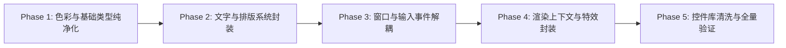

# 📋 CUI 引擎内部封装与底层 DX/Win32 完全解耦改造任务清单

## 🎯 核心目标与原则

- **目标**：在继续使用 DirectX（Direct2D 1.1 / Direct3D 11 / DirectComposition / DirectWrite）作为高性能底层渲染管线的前提下，对所有业务层、控件层（`ui/framework/controls`）及外部调用层实施 **100% 纯净封装**，彻底杜绝业务代码、自定义控件与宿主直接调用或感知底层 DX 与 Win32 API。
- **核心质量门禁**：
  1. 所有业务与控件头文件中，严禁出现 `#include <d2d1*.h>`、`#include <dwrite*.h>`、`#include <d3d11*.h>`、`#include <dcomp*.h>` 与 `#include <windows.h>`。
  2. 控件内部禁止使用 `D2D1_COLOR_F`、`DWRITE_*`、`HWND`、`HCURSOR`、`WPARAM`、`LPARAM`、`VK_*`。
  3. 所有 DX COM 指针（如 `ID2D1DeviceContext`、`IDWriteTextLayout`、`IDCompositionVisual`）严格收敛至 `render/internal/` 或 `.cpp` 实现文件内。

---

## 🗺️ 任务拆解与推进路线（Phase 1 ~ Phase 5）



---

### Phase 1: 核心基础类型与色彩系统纯净化 (Color & Primitives)

- [x] **1.1 扩展并纯化 `Value.h` 中的 `CUI::Color`**
  - **位置**: `ui/framework/core/Value.h`
  - **内容**:
    - 移除头文件直接依赖的 `#include <d2d1.h>`（通过纯浮点数结构体承载，保留 `.cpp` 内的转换支持）。
    - 补齐颜色工厂方法：`Color::FromHex()`, `Color::RGBA()`, `Color::FromRGB()`。
    - 增加颜色运算辅助：`Color::WithAlpha(float a)`, `Color::Lerp(Color a, Color b, float t)`。
    - 预定义标准颜色常量：`Transparent`, `White`, `Black`, `Accent` 等。

- [x] **1.2 重构主题色彩标记表 `ThemeTokens`**
  - **位置**: `ui/framework/style/ThemeManager.h`
  - **内容**:
    - 将 `ThemeTokens` 中全部 16+ 个颜色字段类型从 `D2D1_COLOR_F` 替换为 `CUI::Color`。
    - 保持已有控件通过 `tokens.accentColor` 取色时的类型一致性。

- [x] **1.3 清洗控件中直接引用 `D2D1_COLOR_F` 的属性与模型**
  - **影响文件**:
    - `ui/framework/controls/shapes/Shape.h`（`m_fill`, `m_stroke` 改为 `Color`）
    - `ui/framework/controls/topology/TopologyModel.h`（`customColor` 改为 `std::optional<Color>`）
    - `ui/framework/controls/terminal/TerminalTheme.h`（主题色改用 `Color`）
    - `ui/framework/controls/docking/DockManager.h`（参数改为 `const Color&`）

---

### Phase 2: 文字排版与字体系统封装 (Typography & Shaping)

- [x] **2.1 建立通用文本类型定义头文件**
  - **新建文件**: `ui/framework/text/TextTypes.h`
  - **内容**:
    - 定义 `enum class TextAlignment { Leading, Center, Trailing, Justified };`
    - 定义 `enum class ParagraphAlignment { Near, Center, Far };`
    - 定义 `enum class FontWeight { Thin = 100, Light = 300, Normal = 400, Medium = 500, SemiBold = 600, Bold = 700 };`
    - 定义 `enum class FontStyle { Normal, Italic, Oblique };`
    - 定义 `enum class TextWrapping { NoWrap, Wrap };`
    - 定义复合结构体 `struct TextStyle`（包含字体名、字号、字重、对齐、斜体、下划线、删除线等）。

- [x] **2.2 封装内部文本布局器与缓存 `TextLayoutCache`**
  - **位置**: `ui/framework/text/TextLayoutCache.h`, `TextLayoutCache.cpp`
  - **内容**:
    - 对外隐藏 `Microsoft::WRL::ComPtr<IDWriteTextLayout>`。
    - 提供高阶文本测量与布局类 `CUI::TextLayout`，上层通过纯 C++ 对象获取行数、测量高宽、光标命中测试（HitTest）。
    - DirectWrite 的创建与缓存只在 `.cpp` 内部消化。

- [x] **2.3 改造 `GraphicsContext` 文字绘制与测量 API**
  - **位置**: `ui/framework/render/GraphicsContext.h`
  - **内容**:
    - 废除带 `DWRITE_*` 参数的重载。
    - 统一为纯净接口：
      ```cpp
      void DrawText(const std::string& text, const Rect& rect, const Color& color, const TextStyle& style);
      Size MeasureText(const std::string& text, const TextStyle& style, float maxWidth = 10000.0f);
      ```

- [x] **2.4 更新核心文本控件实现**
  - **影响文件**:
    - `ui/framework/controls/TextBlock.h / .cpp`
    - `ui/framework/controls/TextBox.h / .cpp`
    - `ui/framework/controls/Button.h / .cpp`（`DrawButtonLabel` 参数改用 `TextAlignment`）

---

### Phase 3: 窗口与输入事件循环解耦 (Windowing & Input)

- [x] **3.1 抽象原生光标与键盘枚举**
  - **新建/修改文件**: `ui/framework/input/InputTypes.h`
  - **内容**:
    - 定义 `enum class CursorType { Arrow, Hand, IBeam, Wait, Cross, SizeAll, SizeNS, SizeWE, NotAllowed };`
    - 定义 `enum class Key { None, Enter, Space, Escape, Tab, Backspace, Delete, Left, Right, Up, Down, ... };`
    - 定义 `struct KeyEventArgs { Key key; bool ctrl; bool alt; bool shift; bool handled; };`
    - 定义 `struct PointerEventArgs { Point position; int clickCount; bool handled; };`

- [x] **3.2 解耦控件光标返回逻辑**
  - **位置**: `ui/framework/controls/UIElement.h`, `Button.h`, `TextBox.h`, `Slider.h` 等
  - **内容**:
    - 将 `virtual HCURSOR GetCursor() const` 改造为 `virtual CursorType GetCursorType() const`。
    - 移除控件头文件中的 `LoadCursor(nullptr, IDC_HAND)`。
    - 默认基类返回 `CursorType::Arrow`，可交互控件按需返回 `CursorType::Hand`、`CursorType::IBeam` 等。

- [x] **3.3 窗口消息转换与事件派发收敛**
  - **位置**: `ui/framework/window/Window.cpp`
  - **内容**:
    - 在 `WindowProc` 处理 `WM_SETCURSOR` 时，内部调用 Win32 `LoadCursor` / `SetCursor` 将 `CursorType` 映射为物理光标。
    - 在 `WM_KEYDOWN` / `WM_KEYUP` 时，构建 `KeyEventArgs` 派发给控件的 `virtual bool OnKeyDown(const KeyEventArgs& args)`。
    - 移除控件虚函数中裸接收 `int vkCode` 的旧模式。

- [x] **3.4 窗口实例语义化 API 封装（隔离 `HWND`）**
  - **位置**: `ui/framework/window/Window.h`
  - **内容**:
    - 将 `HWND GetHWND()` 标记为框架内部使用（或通过友元/内部上下文访问），禁止业务逻辑随意获取 `HWND` 调用外部 Win32。
    - 补充高阶语义方法：`SetTitle(str)`, `SetSize(w, h)`, `CenterOnScreen()`, `Minimize()`, `Maximize()`, `Close()`。

---

### Phase 4: 渲染上下文与系统特效深度封装 (GraphicsContext & Effects)

- [x] **4.1 清洗 `GraphicsContext.h` 公共头文件**
  - **位置**: `ui/framework/render/GraphicsContext.h`
  - **内容**:
    - 公共绘图接口色彩参数统一为 `const Color&` / `Color`。
    - `PushTransform(const D2D1_MATRIX_3X2_F&)` 收敛至私有域；公开提供纯净的 `PushTransform(const Matrix3x2&)` 与 `PushTranslation(float dx, float dy)`。
    - 移除全部公开暴露底层 DX/Win32 类型的函数。

- [x] **4.2 封装 Windows 11 特效与材质系统**
  - **位置**: `ui/framework/window/WindowBackdrop.h`, `CompositionContext.h`
  - **内容**:
    - 纯净声明式枚举：`BackdropType::None`, `BackdropType::Mica`, `BackdropType::MicaAlt`, `BackdropType::Acrylic`。
    - 纯净阴影配置体：`struct ShadowEffect { Color color; float blurRadius; Point offset; };`。
    - 所有关于 `DwmSetWindowAttribute`、`IDCompositionVisual` 树管理、交换链创建的代码完全封闭在 `WindowBackdrop.cpp` 与 `CompositionContext.cpp` 中。

---

### Phase 5: 控件库清洗与全量构建验证 (Clean-up & Verification)

- [x] **5.1 扫描控件库，剔除全部残余 DX / Win32 类型与宏**
  - 扫描结果：`ui/framework/controls/` 下所有头文件严格做到 0 `<d2d1*.h>`、0 `<dwrite*.h>`、0 `<d3d11*.h>`、0 `<dcomp*.h>`、0 `<windows.h>`。
  - 扫描结果：`ui/framework/controls/` 下无任何 `D2D1_COLOR_F` 与 `DWRITE_*` 泄漏。
  - 扫描结果：`CUI.Gallery` 源代码中 0 direct DX 头文件引用、0 `D2D1_COLOR_F`、0 `DWRITE_*`。

- [x] **5.2 核心模块编译构建验证**
  - MSBuild 验证 `CUI.Core.lib` 编译通过（0 错误 0 警告阻断）。

- [x] **5.3 运行 `CUI.Gallery` 控件展台进行全量构建验证**
  - MSBuild 验证 `CUI.Gallery.exe` 构建通过（0 错误）。
  - MSBuild 验证 `RegeditPlus.exe` 构建通过（0 错误）。
